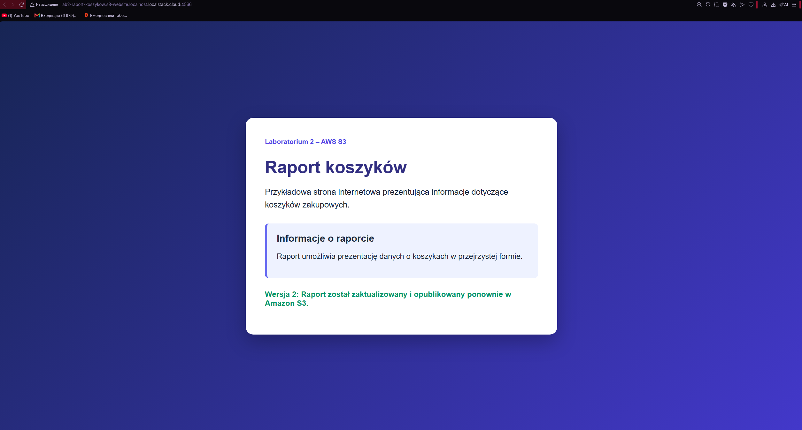
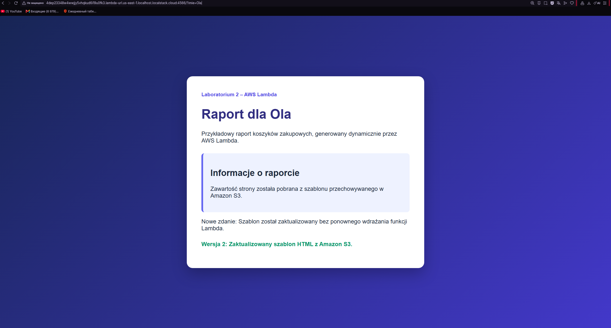
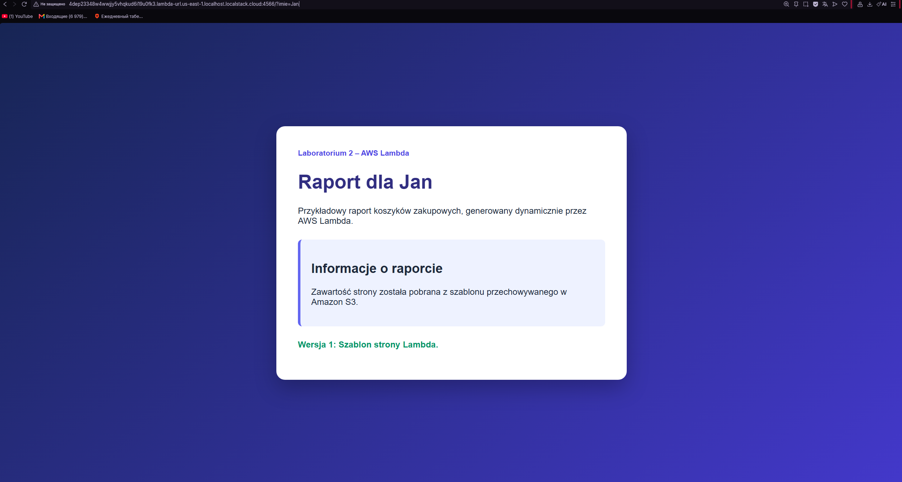
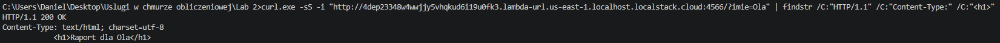
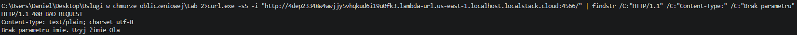
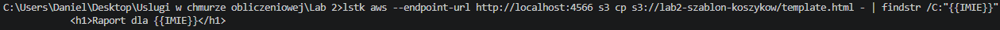

# Laboratorium 2 – Jedna strona, dwa sposoby udostępnienia

**Przedmiot:** Usługi w chmurze obliczeniowej

## 1. Cel laboratorium

Celem laboratorium było przygotowanie strony „Raport koszyków” i udostępnienie jej na dwa sposoby: jako statyczną stronę Amazon S3 oraz jako dynamiczną stronę generowaną przez funkcję AWS Lambda.

Obie usługi uruchomiono lokalnie za pomocą LocalStack i Docker Desktop.

## 2. Przygotowanie środowiska

Wykorzystano następujące narzędzia:

- Windows 11
- Docker Desktop i Docker Compose
- LocalStack
- AWS CLI 2.40.4
- LocalStack CLI (`lstk`) 1.4.5
- Visual Studio Code
- Python

Środowisko skonfigurowano w pliku `compose.yaml`. LocalStack udostępniono lokalnie przez port `4566`. Token aktywacyjny zapisano w pliku `.env`, wykluczonym z repozytorium przez `.gitignore`.

**Polecenia uruchomienia i weryfikacji:**

`docker compose up -d`

`docker compose ps`

`curl.exe http://localhost:4566/_localstack/health`

Wynik: kontener `lab2-localstack` uzyskał status `healthy`, a usługi S3 i Lambda były dostępne.

## 3. Publikacja strony statycznej w S3

Utworzono bucket `lab2-raport-koszykow` i przesłano do niego dwa pliki:

- `index.html` – zawartość strony
- `style.css` – arkusz stylów

Następnie skonfigurowano hosting statyczny z dokumentem startowym `index.html` oraz politykę `bucket-policy.json`, umożliwiającą publiczny odczyt obiektów.

**Najważniejsze polecenia:**

`lstk aws --endpoint-url http://localhost:4566 s3api create-bucket --bucket lab2-raport-koszykow`

`lstk aws --endpoint-url http://localhost:4566 s3api put-bucket-policy --bucket lab2-raport-koszykow --policy file://bucket-policy.json`

`lstk aws --endpoint-url http://localhost:4566 s3 cp www\index.html s3://lab2-raport-koszykow/index.html --content-type text/html`

`lstk aws --endpoint-url http://localhost:4566 s3 cp www\style.css s3://lab2-raport-koszykow/style.css --content-type text/css`

`lstk aws --endpoint-url http://localhost:4566 s3 website s3://lab2-raport-koszykow/ --index-document index.html`

### Aktualizacja strony

Po pierwszej publikacji zmieniono komunikat „Wersja 1” na „Wersja 2”. Następnie ponownie przesłano `index.html` do tego samego bucketu.

Po odświeżeniu przeglądarki zaktualizowana treść pojawiła się pod tym samym adresem. Arkusz CSS nadal był poprawnie ładowany.

**Dowód:**

## 4. Udostępnienie strony przez AWS Lambda

Utworzono drugi bucket `lab2-szablon-koszykow`, w którym umieszczono plik `template.html`. Bucket pozostawiono z domyślnymi ustawieniami dostępu.

Szablon zawiera znacznik `{{IMIE}}`, który funkcja Python zastępuje wartością parametru `imie` pobranego z adresu URL.

Kod funkcji zapisano w pliku `lambda/handler.py`, przygotowano archiwum `lambda-function.zip` i utworzono funkcję `lab2-raport-lambda` w środowisku Python 3.12.

**Polecenia wdrożenia:**

`lstk aws --endpoint-url http://localhost:4566 s3api create-bucket --bucket lab2-szablon-koszykow`

`lstk aws --endpoint-url http://localhost:4566 s3 cp lambda\template.html s3://lab2-szablon-koszykow/template.html --content-type text/html`

`powershell -NoProfile -Command "Compress-Archive -Path 'lambda\handler.py' -DestinationPath 'lambda-function.zip' -Force"`

`lstk aws --endpoint-url http://localhost:4566 lambda create-function --function-name lab2-raport-lambda --runtime python3.12 --handler handler.handler --role arn:aws:iam::000000000000:role/lambda-role --zip-file fileb://lambda-function.zip --timeout 15`

`lstk aws --endpoint-url http://localhost:4566 lambda wait function-active --function-name lab2-raport-lambda`

`lstk aws --endpoint-url http://localhost:4566 lambda create-function-url-config --function-name lab2-raport-lambda --auth-type NONE`

## 5. Testowanie Lambda Function URL

Funkcję sprawdzono z różnymi wartościami parametru oraz bez parametru.

| Żądanie | Oczekiwany wynik |
|---|---|
| `?imie=Ola` | HTTP 200, nagłówek „Raport dla Ola” |
| `?imie=Jan` | HTTP 200, nagłówek „Raport dla Jan” |
| Brak parametru | HTTP 400 i komunikat błędu |

Dla poprawnego żądania serwer zwrócił nagłówek:

`Content-Type: text/html; charset=utf-8`

Dla żądania bez parametru zwrócono:

`HTTP/1.1 400 BAD REQUEST`

`Brak parametru imie. Uzyj ?imie=Ola`

Funkcja wykorzystuje również `html.escape()`, aby znaki specjalne w imieniu były traktowane jako tekst, a nie kod HTML.

### Zrzuty ekranu

**Strona dla Oli:**

**Strona dla Jana:**

**Odpowiedź HTTP 200:**

**Odpowiedź HTTP 400:**

## 6. Aktualizacja szablonu bez ponownego wdrażania funkcji

Do pliku `lambda/template.html` dodano zdanie:

„Nowe zdanie: Szablon został zaktualizowany bez ponownego wdrażania funkcji Lambda.”

Następnie ponownie przesłano plik do bucketu `lab2-szablon-koszykow` jako obiekt `template.html`.

**Polecenie:**

`lstk aws --endpoint-url http://localhost:4566 s3 cp lambda\template.html s3://lab2-szablon-koszykow/template.html --content-type text/html`

Po odświeżeniu strony nowe zdanie było widoczne bez ponownego wdrażania kodu Python.

Sprawdzono również, że obiekt przechowywany w S3 nadal zawiera oryginalny znacznik `{{IMIE}}`.

**Dowód odczytu szablonu z S3:**

## 7. Wnioski

W pierwszym wariancie gotowe pliki HTML i CSS są bezpośrednio udostępniane przez hosting statyczny Amazon S3. Takie rozwiązanie wystarcza dla stron, których zawartość jest jednakowa dla wszystkich użytkowników i nie wymaga przetwarzania danych na serwerze.

W drugim wariancie odpowiedź HTML przygotowuje funkcja AWS Lambda. Funkcja odczytuje parametr z adresu URL, pobiera szablon z S3 i podstawia odpowiednią wartość przed wysłaniem strony do przeglądarki.

Przechowywanie szablonu osobno od kodu funkcji umożliwia aktualizowanie zawartości i wyglądu strony bez ponownego wdrażania Lambdy.

Laboratorium pozwoliło zapoznać się z podstawami hostingu statycznego, funkcji serverless, obsługi żądań HTTP oraz komunikacji pomiędzy usługami AWS w środowisku LocalStack.